# listen-audit

listen-audit reads a saved `ss -tulpn` or `netstat -tulpn` listing and tells you which services are reachable from outside the host and should not be: telnet, FTP, unauthenticated data stores, the Docker API, remote desktop, databases on every interface. Services bound to loopback are treated as safe. It is a short AWK program, so it runs on any Linux box, jump host or incident-response laptop without installing anything.



**Live demo:** https://jvch0512.github.io/listen-audit/ (Synthetic ss and netstat listings from two invented hosts.)

POSIX awk (works with gawk and mawk) plus a small sh wrapper. The demo page is rendered from the tool's `--tsv` output by `scripts/site.py` (Python 3, only needed to regenerate the page).

## Use

```bash
ss -tulpn > web01.txt
./bin/listen-audit web01.txt
./bin/listen-audit examples/*.txt --tsv
ss -tulpn | ./bin/listen-audit - --fail-on high      # exit 1 in CI or a cron job
```

Each file is labelled by its file name (without extension). Use `-` to read from standard input.

| Rule | Severity | What it catches |
|---|---|---|
| LS001 | high | cleartext or legacy remote access reachable from the network: telnet, FTP, TFTP, rsh family, VNC, X11 |
| LS002 | high | data stores and control APIs that ship without authentication by default: Redis, Memcached, MongoDB, Elasticsearch, CouchDB, etcd, Docker API, kubelet |
| LS003 | medium | remote administration or databases on every interface: RDP, SMB, WinRM, MySQL, PostgreSQL, SQL Server, Oracle |
| LS004 | low | infrastructure services that rarely need to face the network: SNMP, rpcbind, NFS |

A listener on `127.0.0.1` or `::1` is never reported.

See [examples](examples) and [docs/sample-output.txt](docs/sample-output.txt).

## Limits

- It judges ports by their well-known numbers. A service on a non-standard port is not recognised, and a standard port can host something else.
- It sees the listening socket only. A firewall that blocks the port is invisible, so treat findings as "listening and possibly reachable".
- Without root, `ss` and `netstat` hide process names for other users. Findings then show `-` as the process.
- Only TCP and UDP listeners are read. Unix sockets are ignored.

## Where it fits

Host hardening reviews, incident triage and audit evidence: a ten-second answer to "what is this machine exposing?", comparable between hosts.

## Tests

```bash
make test    # runs the suite under every awk found (gawk, mawk)
```

MIT.

## Code scanning (SARIF)

`scripts/tsv2sarif.py` converts the `--tsv` output into SARIF 2.1.0, so findings show up in GitHub code scanning:

```sh
./bin/listen-audit examples/web01.txt examples/db01.txt --tsv | python3 scripts/tsv2sarif.py --tool listen-audit --prefix examples > results.sarif
```

Upload `results.sarif` with `github/codeql-action/upload-sarif`. Severities map to SARIF levels (critical and high to error, medium to warning, low and info to note) and to a `security-severity` score.
